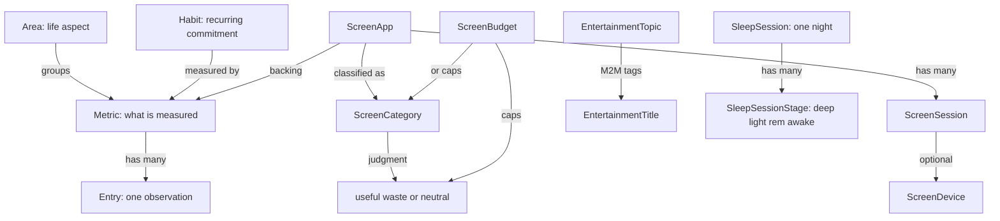
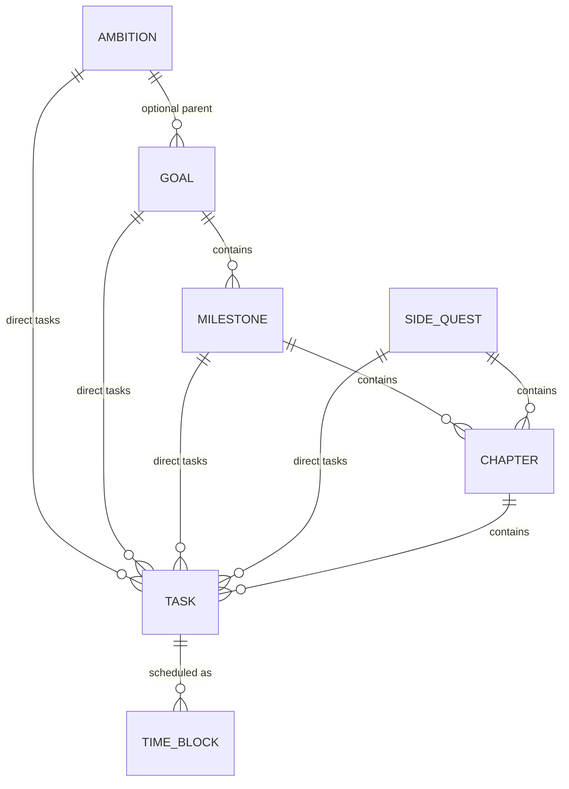

# Data model

All tables at a glance. Field-level tables live in each feature's doc:

| Table | Doc |
| ----- | --- |
| `Area` | [life areas](../domain/life-areas.md#data-model) |
| `Metric`, `Entry` | [trackers and entries](../domain/trackers-and-entries.md#data-model) |
| `Ambition`, `Goal`, `Milestone`, `SideQuest`, `Chapter`, `Task` | [quests](../domain/quests.md#data-model) |
| `TimeBlock` | [time blocks](../domain/time-blocks.md#data-model) |
| `Habit`, `HabitBreak` | [habits](../domain/habits.md#data-model) |
| `ScreenCategory`, `ScreenApp`, `ScreenBudget`, `ScreenDevice`, `ScreenSession` | [screen time](../domain/screen-time.md#data-model) |
| `SleepSession`, `SleepSessionStage` | [sleep](../domain/sleep.md#data-model) |
| Life catalog (journal rows) | [journal](../domain/journal.md#data-model) |
| `EntertainmentTopic`, `EntertainmentTitle`, `EntertainmentTitleTopic` | [entertainment](../domain/entertainment.md#data-model) |
| `SchemaVersion` | [migrations](migrations.md) |

## Overview

Integer primary keys are internal. Slugs are the human key and are what the API accepts: unique per entity type, lowercase, `[a-z0-9-]`. Quest entities (ambitions through time blocks) are the exception: they have no slug and use their integer id on the wire ([decision 0006](../decisions/0006-quest-model-replaces-goals-and-tasks.md)).

Quests are one explicit table per level with typed foreign keys (all `RESTRICT`, all indexed) and CHECK constraints instead of a generic tree, so there are no cycles and an invalid parent combination cannot be stored.

Quest tables (no link to areas, metrics, or habits):

