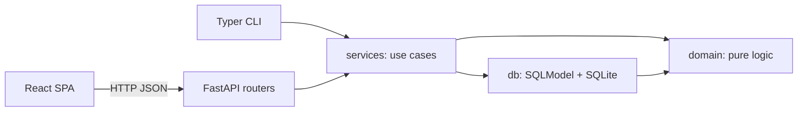

# Architecture overview

How Atlas is built: the layers, what each package owns, the import rules, and where derived
values come from. Feature behaviour lives in [domain/](../domain/).

## Layering



Imports only flow downward:

```
cli, api → services → db, domain
db → domain
domain → (stdlib / typing only)
```

`web/` is not a Python package and is not in this import graph. It talks to the API over HTTP only.

The package lives at `src/atlas/` (src layout), so tests import the installed package rather than the repo root and a packaging mistake fails loudly instead of passing by accident.

| Package             | Responsibility                                                                                                                                                                                             |
| ------------------- | ---------------------------------------------------------------------------------------------------------------------------------------------------------------------------------------------------------- |
| `atlas/settings.py` | Configuration resolved from the environment. Stdlib only, so every layer may import it.                                                                                                                    |
| `atlas/domain/`     | Enums, value objects (`EntryView`, `HabitSpec`, `Bucket`, the quest node and time-block values in `domain/quests.py`, `ScreenCategorySpec`, `ScreenAppSpec`, `ScreenBudgetSpec`, `ScreenSessionSpec`, `ScreenSessionView`, `LibraryTitleView`, `LibraryTopicRef`, `SleepStageSpan`, `SleepSessionSpec`, `SleepSessionView`, `SleepNight`, `SleepWeekMath`), and the calculation functions: period bucketing, rollups, `current_streak`, `longest_streak`, `adherence`, `adherence_counts`, `bucket_target` / `bucket_outcome` (breaks), the quest rules (`validate_*_parent`, `transition_task`, `chapter_state`, `completion_check`, `progress`, `next_action`, `planned_minutes`, `is_unconfirmed`, `complete_block`), `screen_day_totals`, `member_apps`, `resolve_screen_session`, `clip_interval_hours`, `screen_dashboard_math`, `library_dashboard_math`, `resolve_sleep_session`, `sleep_week_math`. Implemented. Pure — no I/O, no session, no wall clock. |
| `atlas/db/`         | SQLModel tables (`Metric`, `Entry`, `Habit`, `HabitBreak`, `HabitSupport`, `Ambition`, `Goal`, `Milestone`, `SideQuest`, `Chapter`, `Task`, `TimeBlock`, `ScreenCategory`, `ScreenApp`, `ScreenBudget`, `ScreenDevice`, `ScreenSession`, `LibraryTopic`, `LibraryTitle`, `LibraryTitleTopic`, `SleepSession`, `SleepSessionStage`, `SchemaVersion`), engine, session factory, schema creation. Implemented. Unique slugs; `Entry` indexed on `(metric_id, occurred_on)`; `ScreenSession` indexed on `(app_id, occurred_on)`; `ScreenApp.metric_id` unique. |
| `atlas/services/`   | Use cases, each taking an explicit `Session` as its first parameter. Loads rows, hands plain values to `domain`, writes results back. Implemented. |
| `atlas/api/`        | FastAPI routers: parse, call a service, serialize. Dedicated request/response schemas only where the wire shape must differ from the table (slugs instead of integer FKs). Implemented. Session comes from a factory dependency; CORS allows the Vite dev origins (`http://127.0.0.1:5173`, `http://localhost:5173`). If `web/dist/index.html` exists, GET 404s fall back to that SPA without shadowing API routes. `uv run uvicorn atlas.api.app:app --reload`, `python -m atlas.api`, and `atlas serve` bind to `127.0.0.1` only. |
| `atlas/cli/`        | Typer commands calling the same services in-process (no HTTP hop). Implemented. Session comes from the factory; commands never query tables. Admin only: `init`, `seed` (through `seed_demo`), `serve`, `export`, `import`. Capture, definition, and review live in the SPA. |

Import rules, enforced by review and by the always-applied architecture rule:

- `atlas/domain/` must not import `atlas.db`, `atlas.api`, `atlas.cli`, or `atlas.services`.
- `atlas/api/` and `atlas/cli/` must not open a session, query tables, or call SQLModel/SQLAlchemy APIs. They obtain a session from the factory and pass it into a service.
- Shared behavior lives in `atlas/services/`, so the API and the CLI cannot diverge.
- `web/` must not import `atlas.*` or reimplement domain calculations. It is the only frontend and an HTTP client of the API.

The first of these is machine-enforced. Ruff's `flake8-tidy-imports` bans `atlas.db`, `atlas.services`, `atlas.api`, and `atlas.cli` project-wide, and `[tool.ruff.lint.per-file-ignores]` lifts the ban everywhere except `atlas/domain/`. An import that breaks domain purity fails `uv run ruff check` rather than waiting for review.

## Derived computations

Nothing in this section is stored. Every definition below is a pure function of stored facts (entries, screen sessions, or library titles) plus configuration and an explicit `as_of` date, so results are reproducible and testable without a database.

The definitions live with each feature:

- Period bucketing and rollup: [trackers and entries](../domain/trackers-and-entries.md#rules-and-calculations)
- Habit satisfaction, streaks, adherence: [habits](../domain/habits.md#rules-and-calculations)
- Quest progress, completion eligibility, chapter state, next action: [quests](../domain/quests.md#rules-and-calculations)
- Planned effort and unconfirmed sessions: [time blocks](../domain/time-blocks.md#rules-and-calculations)
- Library dashboard: [library](../domain/library.md#rules-and-calculations)
- Sleep week: [sleep](../domain/sleep.md#rules-and-calculations)
- Screen dashboard: [screen time](../domain/screen-time.md#rules-and-calculations)

## Services

Implemented. Every use case takes an explicit `Session` as its first parameter, loads table rows, hands `EntryView` / `HabitSpec` / quest node values to `atlas.domain`, and commits its own transaction. Slugs are the lookup key except for entries, sessions, and quest entities (integer `id`). When `occurred_on` or `as_of` is omitted, the service uses `Settings.today()`.

Failures raise `ServiceError` subclasses the API and CLI will map: `NotFoundError`, `AlreadyExistsError` (duplicate slug), `ValidationError` (bad slug, archived target, invalid quest parent, wrong value type), and `ConflictError` (deleting a quest item that still has children, completing an item that is not eligible without override).

Each feature doc lists its service functions under **API**. Export, import, and the demo seed
are in [migrations](migrations.md#export-and-import) and [cli](cli.md#demo-data).
