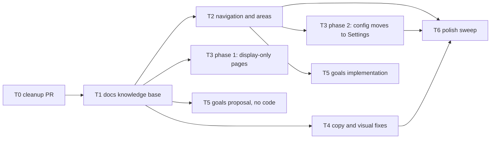

# Atlas restructure plan — November 2026

Status: **proposal, waiting for approval**. Nothing in this plan is implemented yet.

This plan turns the review from 7 Nov 2026 into tracks that can run **in parallel, each on its
own feature branch**, without stepping on each other. It covers:

1. How the work is split, ordered, and kept conflict-free (§1).
2. The documentation knowledge base and how it is enforced before every commit (§2, Track T1).
3. The navigation and concepts redesign: sidebar vs areas, the "Catalog", too many concepts (§3, Track T2).
4. Sleep and Screen Time as display-only pages fed by future pipelines (§4, Track T3).
5. Developer wording and visual bugs (§5, Tracks T4 and a final sweep).
6. Goals review as its own separate topic (§6, Track T5).
7. Decisions that need your answer before work starts (§7).

Out of scope for now, by your call: running Atlas anywhere but on this computer, making New
Entry smarter, and the state of the demo data (synthetic data is fine; we only care that
features work).

---

## 1. How the work is split

### 1.1 Tracks and branches

| Track | Branch | Topic | Runs in |
| ----- | ------ | ----- | ------- |
| T0 | `claude/happy-einstein-d67idi` | Remove dead API surface and marketing skills (already done, needs a PR) | this session |
| T1 | `feature/docs-knowledge-base` | Split docs into a knowledge base, enforce docs-before-commit | this session, **first** |
| T2 | `feature/navigation-and-areas` | Sidebar, life areas, dissolve Catalog into Settings, fewer concepts | own session |
| T3 | `feature/device-data-display-only` | Sleep and Screen Time become display-only; ingestion contract | own session |
| T4 | `feature/ui-copy-and-fixes` | Developer wording and visual bugs in pages nobody else owns | own session |
| T5 | `feature/goals-review` | Goals: proposal first, then implementation | own session, separate |
| T6 | `feature/polish-sweep` | Cross-cutting sweep: date fields, monospace, final copy audit | after T2–T4 merge |

A Claude Code cloud session can only push to the branch it was started with. So each track
runs in **its own session** (I can start them for you, each pointed at its branch and at this
plan). This session keeps T0 and T1, then coordinates.

### 1.2 Order (waves)



- **Wave 0:** T0 merges, then T1 merges. T1 has to land first, because every other track
  updates docs, and today all docs live in one 900-line file that every branch would edit.
- **Wave 1 (parallel):** T2, T3 phase 1, T4, and T5's written proposal.
- **Wave 2:** T3 phase 2 and T5's implementation, once T2 has merged.
- **Wave 3:** T6 sweep.

### 1.3 Rules that keep branches from colliding

1. **File ownership.** Each track edits only the files it owns (table below). If a track needs a
   change in a file it does not own, it writes it down under "Handoffs" in its PR, and the
   owner (or T6) makes it.
2. **Shared files are edited only in your own feature's lines.** These are touched by several
   tracks: `web/src/lib/api.ts`, `src/atlas/api/schemas.py`, `src/atlas/services/__init__.py`,
   `src/atlas/api/app.py`, `tests/api/test_app.py`. Add or remove only the lines for your
   feature, never reorder or reformat others', and rebase on `main` before merging.
3. **One schema change per wave.** Only T2 bumps the database schema in wave 1 (to version 11).
   T5 takes version 12 in wave 2. T3 makes no schema change (the pipeline comes later).
4. **Docs per feature.** After T1, each feature has its own doc file. A track edits its own
   domain docs and adds a changelog fragment (`docs/changelog/unreleased/<branch>.md`) instead
   of appending to a shared log, so changelog entries never conflict.
5. **Seed data by function.** In `src/atlas/services/seed.py`, T2 edits only `_areas()`, and T4
   only `_habits()`.

### 1.4 File ownership

| Files | Owner |
| ----- | ----- |
| `docs/**` structure, `CLAUDE.md`, `.claude/rules/**`, `.claude/hooks/**`, `.claude/skills/docs-sync/**` | T1 |
| `web/src/components/Layout.tsx`, `web/src/App.tsx`, `web/src/lib/sections.ts`, `web/src/pages/{AreaPage,CatalogPage,SectionPage}.tsx`, new `web/src/pages/SettingsPage.tsx`, `web/src/components/ProfileDialog.tsx`, `web/src/components/habits/HabitFormDialog.tsx` (area picker only), new `web/src/lib/labels.ts`, `src/atlas/services/areas.py`, `src/atlas/services/metrics.py`, `src/atlas/db/models.py` + `engine.py` (wave 1), `docs/product/navigation.md`, `docs/domain/life-areas.md` | T2 |
| `web/src/pages/{SleepPage,ScreenPage,EntriesPage}.tsx`, `web/src/components/home/{SleepCard,ScreenTimeCard,Charts}.tsx`, `web/src/components/screen/**`, new `web/src/components/settings/{ScreenTimeSettings,DataSourcesSettings}.tsx`, `src/atlas/services/{sleep,screen,entries}.py` (filters only), `docs/domain/{sleep,screen-time,history}.md`, `docs/data-sources/**` | T3 |
| `web/src/components/{LogDialog,LogForm}.tsx`, `web/src/components/home/HomeCards.tsx`, `web/src/pages/TasksPage.tsx`, `web/src/components/habits/HabitCard.tsx`, `web/src/pages/{HabitsPage,HabitPage}.tsx`, `src/atlas/services/habits.py` (labels only), `docs/domain/{tasks,habits,home}.md` | T4 |
| `web/src/pages/{GoalsPage,GoalPage}.tsx`, `web/src/components/goals/**`, `src/atlas/services/goals.py`, `src/atlas/domain/goals.py`, `docs/domain/goals.md` | T5 |
| Everything still unowned, plus cross-cutting sweeps | T6 |

---

## 2. Track T1 — Documentation knowledge base and enforcement

### 2.1 Why

All knowledge lives in one long `docs/architecture.md` (data model, rules, API, frontend,
development log). It is hard to find things, every branch edits the same file, and nothing
stops a commit that changes code without updating docs.

### 2.2 Proposed structure

```text
docs/
├── README.md                  Index, how to navigate, which code maps to which doc
├── product/                   What Atlas is, for whom, and how it should feel
│   ├── vision.md              Local-first, single user; what Atlas is and is not
│   ├── glossary.md            Every user-facing concept and its name in the code
│   ├── navigation.md          Sidebar, routes, page inventory with status
│   ├── ux-writing.md          Voice and tone; banned developer words; how to label options
│   └── design-system.md       Colour tokens, typography, components, light/dark
├── architecture/              How it is built
│   ├── overview.md            Layers (domain / db / services / api / cli / web), import rules
│   ├── data-model.md          Diagram of all tables, linking to each feature's doc
│   ├── migrations.md          Schema versions 1→N, what each changed, import compatibility
│   ├── api-conventions.md     Slugs, as_of, errors, status codes, query filters
│   ├── frontend.md            Stack, routing, API client, theming, testing
│   ├── cli.md                 Admin commands
│   └── configuration.md       ATLAS_DB, ATLAS_TZ, ports
├── domain/                    One file per feature, all with the same template
│   ├── trackers-and-entries.md   (today: metrics, entries, rollups)
│   ├── life-areas.md
│   ├── habits.md
│   ├── goals.md
│   ├── tasks.md
│   ├── journal.md
│   ├── sleep.md
│   ├── screen-time.md
│   ├── entertainment.md
│   ├── home.md
│   └── history.md
├── data-sources/              Data that arrives from devices, not from typing
│   ├── overview.md            Display-only principle and the ingestion contract
│   ├── sleep.md               Expected fields, timezones, de-duplication; sources TBD
│   └── screen-time.md         Same, for app sessions
├── development/
│   ├── setup.md               Install and run (README links here)
│   ├── workflow.md            Branch per topic, PRs, checks before commit
│   ├── parallel-work.md       File ownership and shared-file rules (from §1.3)
│   ├── testing.md             What to test in each layer
│   └── docs-sync.md           The docs-before-commit rule and how to follow it
├── decisions/                 Short records of choices that should not be re-argued
│   ├── 0001-local-first-single-user.md
│   ├── 0002-progress-computed-on-read.md
│   ├── 0003-web-app-is-the-only-frontend.md
│   ├── 0004-device-data-is-display-only.md
│   └── 0005-docs-change-with-code.md
├── changelog/
│   ├── README.md              How fragments work
│   ├── 2026.md                The current development log, moved here unchanged
│   └── unreleased/            One file per branch, folded into 2026.md on merge
└── plans/                     Active plans like this one
```

Every `domain/*.md` uses the same headings: **Purpose · Concepts · Data model · Rules and
calculations · API · Screens · Tests · Status**. So for any feature you know exactly where to
look, and a reviewer can check each heading against the code.

T1 moves content; it does not rewrite behaviour. Each section of today's `architecture.md`
goes to exactly one new file, and `architecture.md` itself is removed (README and CLAUDE.md
point to `docs/README.md`).

### 2.3 Enforcement: docs reviewed before every commit

Three layers, from soft to hard:

1. **Rule** — `.claude/rules/documentation.md` is rewritten around a **code → doc map** (for
   example `src/atlas/services/habits.py` → `docs/domain/habits.md`). It loads in every
   session.
2. **Skill** — new `.claude/skills/docs-sync/`: given the staged diff, list the docs that map
   to the changed files, re-read each one against the code, fix anything stale, and stage the
   doc changes.
3. **Hook (hard gate)** — a `PreToolUse` hook on `git commit` (same mechanism as the existing
   uv/pnpm hook). If the commit stages files under `src/` or `web/src/` but nothing under
   `docs/`, the commit is **blocked** with a message pointing at the docs-sync skill. If the
   docs were reviewed and genuinely need no change, the commit message must carry the line
   `Docs-Reviewed: no change needed`, which the hook accepts.

Plus two mechanical drift checks that run with the normal tests:

- **pytest:** every route in the API appears in the doc tables, and every documented route
  exists.
- **vitest:** every route in `App.tsx` appears in `docs/product/navigation.md`.

Optional, if you want your own commits gated too: the same check as a git `pre-commit` hook
(`.githooks/pre-commit`, enabled with `git config core.hooksPath .githooks`). The Claude hook
only applies to Claude sessions.

### 2.4 Done when

- `docs/` has the tree above, and nothing from `architecture.md` was lost (checked by a
  section-by-section mapping in the PR description).
- The hook blocks a code-only commit in a test run, and allows it with the trailer.
- Both drift checks pass and fail when a route is added without docs.

---

## 3. Track T2 — Navigation, life areas, and fewer concepts

### 3.1 What is confusing today

The app groups things along **three different axes** but shows them as one flat list:

| Axis | What it answers | Today it appears as |
| ---- | --------------- | ------------------- |
| **Part of life** | "Which part of my life is this about?" | *Areas* (Health, Career, Finance, Relationships), only visible inside Catalog and on hidden `/area/...` pages |
| **What you do about it** | "What am I committing to or working on?" | Goals, Habits, Tasks, Journal in the sidebar |
| **What gets recorded for you** | "What do my devices say?" | Sleep, Screen Time in the sidebar, mixed with the above |

On top of that, the sidebar has hard-coded **Health** and **Adventure** pages that are empty
and unrelated to the **Health** *area* that already holds the health metrics and goals. Same
word, two different things, one of them empty. That is the main conflict.

**What "Catalog" is:** today, a single admin page (reached only through the settings gear) where
you create and edit the app's building blocks — areas, metrics, habits, goals — as raw forms.
It exposes internal fields (slugs, `higher_is_better`, `at_least`, `sum`/`last`), and it
duplicates things that already exist elsewhere: the Habits page already has "New habit", the
Goals page already has "New goal". In short, Catalog is the database's admin screen showing
through.

### 3.2 Proposed model

Keep everything you can do today (you prefer comprehensive), but give each concept one home and
one name, and group the sidebar by the three axes:

```text
Atlas
  Today                      (Home dashboard)

  PLAN & ACT                 what you commit to and do
  Goals
  Habits
  Tasks
  Journal

  LIFE AREAS                 your own list, ordered by you, + "New area"
  Health
  Career
  Finance
  Relationships
  Adventure

  TRACKED FOR YOU            display only, filled by data sources
  Sleep
  Screen Time

  LIBRARY
  Entertainment

  ───────────
  History                    everything ever recorded, editable
  Settings
```

- **Life areas become real sidebar entries.** The list comes from your areas, so Health is the
  same Health everywhere. Adventure becomes an ordinary area. The empty hard-coded section pages
  disappear (old links redirect: `/health` → `/area/health`).
- **Each life area page is a full dashboard** (the comprehensive side): its trackers with a
  30-day sparkline, latest value and trend; the habits in it, with this week's grid; goals
  tagged with it; tasks linked to those goals; recent records; and a "Manage" panel to rename,
  pick an icon and colour, and add, edit or archive its trackers.
- **Catalog is dissolved.**
  - Habits and goals are created and edited only on their own pages (already possible).
  - Areas and their trackers are managed on each area's page, plus a
    **Settings › Life areas** list for reordering and archiving.
  - Screen Time configuration goes to **Settings › Screen Time** (see T3).
  - `/catalog` redirects to Settings.
- **Settings becomes a page** instead of the small Profile dialog, with tabs: Profile and theme ·
  Life areas · Screen Time (T3) · Data sources (T3) · Advanced. The "As of" date moves to
  Advanced, and when it is set, a visible banner says "Viewing Atlas as of 3 Oct 2026 —
  Back to today" on every page, so it can't be left on by accident.
- **The bell is removed** until there are real notifications.

### 3.3 Fewer concepts: one name per idea

| In the code today | Shown to you as | What changes |
| ----------------- | --------------- | ------------ |
| Area | **Life area** | Sidebar group, own dashboard. Internal areas (`screen`, `life`, `habits`) are flagged *system* and never shown. |
| Metric | **Tracker** | "Something you measure." Created inside a life area, or automatically by a habit or goal. The three technical fields (`value_type`, `aggregation`, `direction`) collapse into one plain choice of **preset** (below). |
| Entry | **Record** | One logged value. Shown in History and on area pages. |
| Habit, Goal, Task, Journal | same | Unchanged names. Goal details are T5's topic. |
| Milestone | step of a goal | Stays inside a goal (T5). |
| Screen category / app / device / cap | Screen Time settings | Configuration only, in Settings. |
| Sleep session / stage | night | Never edited by hand; just shown. |
| Entertainment topic | tag | Rename in the UI only. |
| Slug | — | Never shown. Generated from the name. |
| Catalog, Profile dialog, Week page | — | Removed (redirects kept). |

**Tracker presets** replace the raw type / aggregation / direction fields:

| Preset | Example | Stored as |
| ------ | ------- | --------- |
| Yes / no | Meditated | `bool`, sum |
| Count per day | Pushups, coffee | `count`, sum (you pick: more is better / less is better) |
| Measurement | Weight, savings | `quantity`, latest |
| Time spent | Deep work | `duration`, sum |
| Rating 1–10 | Mood | `rating`, average |
| Note | Journal | `text`, latest |

An "Advanced" disclosure still shows the exact fields for anyone who wants them.

For daily use this leaves **four things you act with** (goals, habits, tasks, journal), **one
way to organise them** (life areas), and **one thing you measure with** (trackers). Everything
else is configuration in Settings or display-only.

### 3.4 Work items

**Backend** (schema version 11)

- `Area` gains `is_system` (bool), `icon`, `color`, `position`. A migration flags `screen`,
  `life`, and `habits` as system areas. `GET /areas` hides system areas by default.
- `PATCH /areas/order` saves the order of the sidebar list.
- `area_view` gains: a 30-day series per tracker, tasks linked through the area's goals, and
  recent records.
- Habit creation accepts an optional `area`. Without one, it keeps today's behaviour: the
  hidden `habits` system area.
- Seed data: add an Adventure area, plus icons and colours.

**Web**

- `Layout.tsx`: grouped sidebar with life areas loaded from the API; the bell is removed.
- `App.tsx`: `/settings/*` routes; redirects for `/catalog`, `/health`, `/adventure`, `/week`.
- New `SettingsPage.tsx` with a small **tab registry** (`lib/settings.ts`), so T3 can add its
  tabs with one line.
- Rebuild `AreaPage.tsx` as the dashboard described above, with a Manage panel.
- New `lib/labels.ts`: plain-language labels for every enum, used everywhere instead of raw
  values.
- Delete `CatalogPage.tsx`, `SectionPage.tsx`, `ProfileDialog.tsx`, and the health/adventure
  entries in `sections.ts`.
- Habit form: optional life-area picker.

**Docs:** `product/navigation.md`, `product/glossary.md`, `domain/life-areas.md`,
`domain/trackers-and-entries.md`, `architecture/migrations.md`.

**Tests:** migration from v10 (system flags set), area ordering, `area_view` series, sidebar
renders areas from the API, redirects.

---

## 4. Track T3 — Sleep and Screen Time are display-only

### 4.1 Principle

Sleep and Screen Time data will come from devices through a pipeline built later. The pages
**only show data**. There is no way to type, edit, or delete nights or app sessions in the UI.
Until the pipeline exists, the demo seed fills them with synthetic data.

What is *configuration* rather than data (which apps count as good or bad, which category an
app belongs to, daily caps, device names) stays editable, but in Settings, not on the display
pages (decision 1 in §7).

### 4.2 Phase 1 — independent of T2

**Remove manual capture from the UI**

- Home Sleep card: remove "Log night" and its form.
- Sleep page: remove night delete.
- Screen Time page: remove "Log a session" and the Sessions edit/delete card.
- Remove the client functions those used.

**Keep the API as the ingestion door**

- `POST /sleep/sessions` and `POST /screen/sessions` stay, documented in
  `docs/data-sources/overview.md` as the contract a future pipeline will call.
- Deduplication with an external id is noted there as future work; no schema change now.

**Better display, still read-only**

- Sleep page: a range picker (week / month / 90 days); trend of time asleep; bedtime and wake
  consistency; average stage split; nights without data shown as visible gaps ("No data"); a
  read-only list of nights.
- Screen Time: plain-language score explanation; remove "Zeros included across the clipped
  range"; category legend uses per-category colours (today they are coloured by good/bad, so
  categories can't be told apart); axis labels on the daily bars.
- Empty states, when there's no data: "No sleep data yet. It will appear here once a data
  source is connected", linking to the data-sources doc.
- Each page shows "Last updated <time>" from the newest record.

**History stops being flooded**

- History gets a "Hide automatic data" switch, on by default. It hides records created from
  Screen Time sessions, using a new `exclude_area` filter on `GET /entries`.

**Fix in T3's files:** clipped "22:00" label on the sleep chart, the "22 stages" wording, the
Screen Time jargon listed above.

### 4.3 Phase 2 — after T2 merges

- Move the Manage card (categories, app→category) and the Caps card into
  `components/settings/ScreenTimeSettings.tsx`. Devices go into `DataSourcesSettings.tsx`.
  Register both as Settings tabs.

**Docs:** `domain/sleep.md`, `domain/screen-time.md`, `domain/history.md`, `data-sources/*`,
decision record `0004-device-data-is-display-only.md`.

**Tests:** the pages render with no capture controls; `GET /entries?exclude_area=screen`; the
ingestion endpoints still accept data.

---

## 5. Track T4 — Developer wording and visual bugs

### 5.1 Every issue found, with its owner

| # | Issue | Where | Owner |
| - | ----- | ----- | ----- |
| 1 | "This section ships with the matching domain cycle." | Health / Adventure pages | T2 (pages removed) |
| 2 | "Good + half of Neutral, over total. UI labels Good / Bad / Neutral." | Screen Time score | T3 |
| 3 | "Zeros included across the clipped range." | Screen Time | T3 |
| 4 | "· 22 stages" on every night | Sleep page | T3 |
| 5 | "One capture path. Counts for 2026-11-07." | New Entry dialog | **T4** |
| 6 | New Entry opens on "Books" with value 0 | New Entry dialog | **T4** |
| 7 | Habit names built from IDs ("Coffee Daily", "Meditated Daily") | seed + habit forms | **T4** |
| 8 | "Deep Work Weekdays" tagged "Daily" | habit frequency tag | **T4** |
| 9 | Raw enum values (`higher_is_better`, `at_least`, `sum`) | Catalog, forms | T2 (`labels.ts`) |
| 10 | Sleep chart's top time label clipped | Sleep card / page | T3 |
| 11 | Home habits grid cut off on phone (Sat/Sun hidden) | Home | **T4** |
| 12 | Goals board's fourth column cut off on a laptop | Goals | T5 |
| 13 | Mixed date formats (`10/09/2026` vs "7 November 2026") | all date inputs | T6 |
| 14 | Monospace used inconsistently | many pages | T6 |
| 15 | Full-width "Today" dropdown on every task | Tasks | **T4** |
| 16 | Category legend coloured by good/bad | Screen Time | T3 |
| 17 | Bell only ever says "No notifications" | header | T2 |
| 18 | "As of" date silently changes every page | Profile dialog | T2 |
| 19 | History flooded with Instagram / YouTube rows | History | T3 |
| 20 | Missing sleep night shows as a silent blank column | Sleep | T3 |

### 5.2 T4 work items

- **New Entry:** plain description ("Log a value for today"), no preselected tracker, unit
  shown next to the value field, placeholder instead of a 0 value.
- **Habits:** names are written by people, not generated. Seed uses names like "Meditate",
  "At most one coffee", "Deep work on weekdays". The frequency tag says "Weekdays" (or lists
  the days) when a habit has a weekday schedule.
- **Home habits grid:** fits a phone (scrolls horizontally with the habit name pinned, or
  shows fewer days).
- **Tasks:** replace the full-width dropdown with a compact "Move to…" menu button.
- **Writing rule:** add a check to `docs/product/ux-writing.md` (written in T1) and fix any
  other developer wording found in T4's own files.

### 5.3 T6 sweep, after T2–T4 merge

- One `DateField` component that always shows dates as "7 Nov 2026" and wraps the native
  picker. Replace every raw `<input type="date">`.
- Monospace only for tabular numbers (one utility class); remove the other uses.
- A final copy audit of every page against `ux-writing.md`.

---

## 6. Track T5 — Goals review (separate topic)

Run in its own session and branch, in two steps:

1. **Proposal (wave 1, no code):** `docs/plans/goals-redesign.md`. Questions to settle:
   - What "on track" means for a goal with no tracker (today: "Behind" with an empty bar, or
     "No data").
   - Whether long-term goals are measured at all, or only through their child goals.
   - What the column headers ("0 / 3 goals on track · 0%") should say.
   - Milestone goals vs. tracker goals.
   - Whether finishing linked tasks should move a goal, and how.
   - What the "Weekly Action Plan" column is for.
   - Layout that fits a laptop screen (four columns overflow today).
2. **Implementation (wave 2, after T2):** schema version 12 if needed; owns the goals files in
   §1.4.

---

## 7. Decisions needed before starting

1. **Screen Time configuration** (which apps are good or bad, app categories, daily caps,
   device names) is configuration, not data. Keep it editable in Settings › Screen Time?
   *Recommended: yes.*
2. **Health and Adventure** become ordinary life areas in a dynamic sidebar list?
   *Recommended: yes.*
3. **Names:** "Tracker" for metric, "Record" for entry, "Life area" for area? *Recommended:
   yes; they only change in the UI, not in the code or API.*
4. **Habit trackers:** the habit form gets an optional life-area picker? *Recommended: yes.*
5. **Docs gate:** a hard block on code commits without docs (with the `Docs-Reviewed` escape
   line)? Also add the git `pre-commit` version for your own commits? *Recommended: hard block
   for Claude; your own hook optional.*
6. **Execution:** after T1 merges, I start four sessions (T2, T3, T4, T5-proposal), each on
   its branch with this plan as the brief? *Recommended: yes.*
