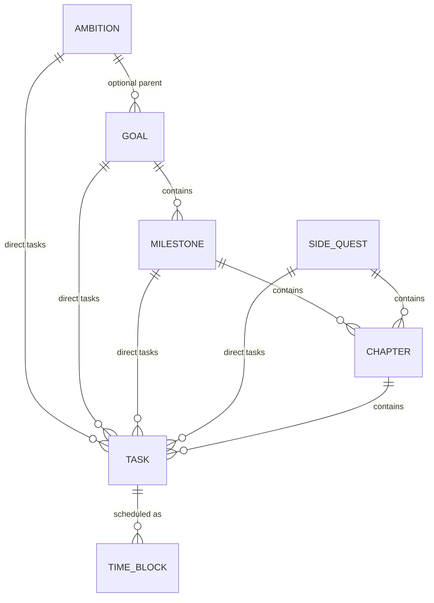

# Quests: implementation plan

Status: **approved for direct implementation (8 Nov 2026).** The quest model **replaces** goals
and tasks outright. Existing goal and task behaviour, data, endpoints, and pages are removed, not
migrated or kept in parallel. This replaces Track T5 in
[2026-11-restructure.md](2026-11-restructure.md) and the brief
[discussions/goals.md](discussions/goals.md).

Source brief: the "Personal Goals & Execution Platform" master prompt (8 Nov 2026). "P7.2"
means part 7.2 of that brief. The brief is the product spec; this plan is how it lands in Atlas.

---

## 0. Direction

- **Clean replacement.**
  - The old `goal`, `milestone`, and `task` tables and every feature built on them are deleted:
    horizons, the goal tree, pace, metric-target goals, checkpoint milestones, task buckets, the
    Goals board, the Tasks page, the Home Tasks card, habit ↔ goal links, area-tagged goals,
    and goals on area pages.
  - Nothing is migrated: the existing data is demo data, and the seed is rewritten for quests.
- **The quest model** from the brief: Ambition → Goal → Milestone → Chapter → Task, Side Quests,
  the Inbox, and Time Blocks, with optional intermediate levels (P4).
- **One explicit table per entity**, typed foreign keys, CHECK constraints, no generic node table,
  no self-reference (so no cycles).
- **Stored vs computed.**
  - Stored: only explicit user decisions (statuses, completion, weights, order).
  - Computed on read: progress, completion eligibility, chapter state, next action, planned
    effort, and unconfirmed sessions
    ([decision 0002](../decisions/0002-progress-computed-on-read.md)).
- **Atlas conventions stay:** the layers (domain ← db ← services ← api), uv / pnpm, the docs gate,
  single user on localhost ([decision 0001](../decisions/0001-local-first-single-user.md)).

---

## 1. What is removed

| Area | Removed |
| ---- | ------- |
| Database | Tables `goal`, `milestone`, `task`; column `habit.goal_id`. Schema **11** drops them on startup |
| Domain | `domain/goals.py` (goal progress, pace), `domain/horizons.py`; enums `GoalKind`, `GoalStatus`, `GoalHorizon`, `Measure`, `PaceStatus`, `TaskBucket`, `TaskPriority` (replaced) |
| Services | `services/goals.py`, `services/tasks.py` (rewritten from scratch), goal parts of `views.py` (`goals_board`, goals in `area_view`), goal linking in `habits.py`, goal and task sections of `port.py` and `seed.py`, goal lookups in `lookups.py` / `mapping.py` |
| API | `/goals*`, `/views/goals`, `/tasks*` (old shapes); `goal` on habit create/update; `goals` in `/views/areas/{slug}` |
| Web | `GoalsPage`, `GoalPage`, `TasksPage`, `components/goals/*`, `components/tasks/*`, `lib/horizons.ts`, `lib/tasks.ts`, the Home Tasks card, the habit form's goal select, goal sections on Area and Catalog pages, `PaceBadge` |
| Import | Exports with `schema_version` 1–10 still import. Their `goals`, `milestones`, and `tasks` sections are **ignored**, and the import summary says so |
| Docs | `docs/domain/goals.md` and `docs/domain/tasks.md` are replaced by `docs/domain/quests.md` and `docs/domain/time-blocks.md` |

---

## 2. Entities

Every container (Ambition, Goal, Milestone, Side Quest) has: `title`, optional `description`, an
optional date, `weight` (nullable, relative to its parent), `position` (order among siblings),
`status`, `completed_at`, `archived_at`, `created_at`, `updated_at`.

| Entity | Belongs to | Contains | Extra fields | Status |
| ------ | ---------- | -------- | ------------ | ------ |
| **Ambition** | — | Goals, direct Tasks | `target_on` | `active` / `completed` / `archived` |
| **Goal** | optional Ambition | Milestones, direct Tasks | `due_on`, `success_description` | `active` / `completed` / `archived` |
| **Milestone** | one Goal | Chapters, direct Tasks | `due_on` | `active` / `completed` / `archived` |
| **Side Quest** | — | Chapters, direct Tasks | `due_on` | `active` / `completed` / `archived` |
| **Chapter** | exactly one Milestone **or** Side Quest | Tasks | — | **computed**: `empty` / `not_started` / `in_progress` / `completed` |
| **Task** | at most one of: Ambition, Goal, Milestone, Chapter, Side Quest | Time Blocks | `priority` (low / normal / high), `estimate_minutes`, `due_on`, `organized_at`, `started_at` | `todo` / `in_progress` / `completed` (+ `archived_at`) |
| **Time Block** | exactly one Task | — | `start_at`, `end_at` (UTC), `provider` (`internal`), `external_event_id` | `scheduled` / `completed` / `cancelled` |

**Derived, not stored:**

- **Main Quest:** a Goal and everything under it.
- **Side Quest:** a Side Quest row and everything under it, plus a **standalone** task (no parent,
  `organized_at` set).
- **Inbox:** a task with no parent and `organized_at` empty.
- A task directly under an Ambition shows under its Ambition; it is neither a Main Quest nor a
  Side Quest (P3.2).

Organizing or moving a task changes one foreign key (and stamps `organized_at`). Its id, status,
history, and time blocks are kept.



---

## 3. Schema (version 11)

Times are UTC datetimes; `*_on` columns are local dates in `ATLAS_TZ`.

```text
ambition     id · title · description? · target_on? · weight? · position
             status · completed_at? · archived_at? · created_at · updated_at
goal         id · ambition_id? → ambition · title · description? · success_description?
             due_on? · weight? · position · status · completed_at? · archived_at? · created_at · updated_at
milestone    id · goal_id → goal · title · description? · due_on? · weight? · position
             status · completed_at? · archived_at? · created_at · updated_at
side_quest   id · title · description? · due_on? · position
             status · completed_at? · archived_at? · created_at · updated_at
chapter      id · milestone_id? → milestone · side_quest_id? → side_quest · title · description?
             weight? · position · archived_at? · created_at · updated_at
             CHECK exactly one of milestone_id / side_quest_id
task         id · title · description? · status · priority · estimate_minutes? · due_on?
             weight? · position · ambition_id? · goal_id? · milestone_id? · chapter_id? · side_quest_id?
             organized_at? · started_at? · completed_at? · archived_at? · created_at · updated_at
             CHECK at most one parent column set
             CHECK parent set ⇒ organized_at set
             CHECK status = 'completed' ⇔ completed_at set
             CHECK estimate_minutes IS NULL OR estimate_minutes > 0
time_block   id · task_id → task · start_at · end_at · status · provider · external_event_id?
             created_at · updated_at
             CHECK end_at > start_at
             UNIQUE (provider, external_event_id) where external_event_id is set
```

- **Every foreign key is `RESTRICT` and indexed.** Also indexed: `task(organized_at)` and
  `time_block(start_at)`.
- **Deleting:**
  - A container can be deleted only when it has no children; otherwise archive it.
  - A task can be deleted only from the Inbox and without time blocks.
  - A time block can be deleted (a mistaken entry); otherwise cancel it.
- **Schema 11 on startup:** drop `goal`, `milestone`, `task` (and `habit.goal_id`, via the table
  rebuild pattern), then create the seven tables. Exports bump to version 11 with the new
  sections.

---

## 4. Rules (pure functions in `src/atlas/domain/quests.py`)

### 4.1 Structure

- Allowed parents exactly as in §2.
- A milestone moves only between goals; a chapter only between milestones and side quests.
- Archived containers accept no new children.
- Nothing is ever created automatically (P4).

### 4.2 Task status

- `todo ⇄ in_progress ⇄ completed`; any status can return to any other (reopen).
- `started_at` is stamped the first time a task leaves `todo`.
- `completed_at` is set on completion and cleared on reopen.
- Only an explicit action completes a task (P6.3).

### 4.3 Chapter state

- `empty`: no non-archived tasks.
- `completed`: every task is completed.
- `in_progress`: any task is in progress or completed.
- `not_started`: otherwise.

An empty chapter is never completed (P2.4).

### 4.4 Completion eligibility

| Item | Eligible when it has ≥ 1 non-archived child and… |
| ---- | ------------------------------------------------ |
| Milestone, Side Quest | every direct task and every chapter is completed |
| Goal | every direct task and every milestone is completed |
| Ambition | every goal and every direct task is completed |

- **Completing is always explicit.** The API returns `eligible` and the open children.
- **Override:** completing an item that isn't eligible needs `override: true`. Its children keep
  their statuses, and the item then reads `completed_with_open_items: true`, which the UI shows.
- Reaching 100 % never completes anything (P7.2).

### 4.5 Progress

```text
progress(task)      = 1 if completed else 0
progress(container) = 1     if the container is completed (manually or not)
                    = None  if it has no non-archived children        → "Not broken down yet"
                    = Σ wᵢ·pᵢ / Σ wᵢ over non-archived children,
                        wᵢ = child.weight or 1,  pᵢ = progress(child) with None counted as 0
```

- **Children:** Ambition → goals and direct tasks; Goal → milestones and direct tasks;
  Milestone and Side Quest → chapters and direct tasks; Chapter → tasks.
- **Weights** are relative among siblings and shown normalized as percentages.
- **One place:** this is the only progress algorithm. Views also return `done_tasks` /
  `total_tasks` counts.

### 4.6 Next action

1. The task with the earliest upcoming `scheduled` block under the item.
2. Otherwise the first `in_progress` task in tree order (by position).
3. Otherwise the first `todo` task, nearest due date first, then higher priority.
4. Otherwise none (the UI shows an "Add a task" prompt).

### 4.7 Time blocks

- **Planned effort** = Σ (`end_at` − `start_at`) over non-cancelled blocks, summed up the tree.
  It's shown beside the estimate and never called actual effort (P6.4).
- **Completing a block** sets it `completed`, and moves a `todo` task to `in_progress`. Nothing
  else changes.
- **Cancelling a block** keeps the row.
- **Unconfirmed** is computed: a block still `scheduled` after its `end_at`.
- Overlapping blocks are allowed (the calendar marks them).
- A completed task accepts no new blocks until it's reopened.

---

## 5. API (integer ids everywhere)

| Method | Path | Purpose |
| ------ | ---- | ------- |
| `GET` `POST` | `/ambitions` | List with computed state; create |
| `GET` `PATCH` `DELETE` | `/ambitions/{id}` | Read; edit (title, description, `target_on`, weight, position, archive); delete when empty |
| `POST` | `/ambitions/{id}/complete`, `/ambitions/{id}/reopen` | Explicit completion; `override` when not eligible |
| `GET` `POST` | `/goals` | List; create with optional `ambition_id` |
| `GET` `PATCH` `DELETE` | `/goals/{id}` | Read; edit (including moving to another ambition or none); delete when empty |
| `POST` | `/goals/{id}/complete`, `/goals/{id}/reopen` | As above |
| `POST` | `/milestones` | Create (`goal_id`) |
| `GET` `PATCH` `DELETE` | `/milestones/{id}` | Read, edit or move, delete when empty |
| `POST` | `/milestones/{id}/complete`, `/milestones/{id}/reopen` | As above |
| `GET` `POST` | `/side-quests` | List; create |
| `GET` `PATCH` `DELETE` | `/side-quests/{id}` | Read, edit, delete when empty |
| `POST` | `/side-quests/{id}/complete`, `/side-quests/{id}/reopen` | As above |
| `POST` | `/chapters` | Create (`milestone_id` xor `side_quest_id`) |
| `GET` `PATCH` `DELETE` | `/chapters/{id}` | Read, edit or move, delete when empty |
| `GET` `POST` | `/tasks` | List (`parent_kind` + `parent_id`, `status`, `inbox`, `standalone`, `due_on`); create. With no parent it lands in the Inbox (only `title` required) |
| `GET` `PATCH` `DELETE` | `/tasks/{id}` | Read with blocks and planned effort; edit (status, priority, estimate, due, weight, position, archive); delete only from the Inbox without blocks |
| `POST` | `/tasks/{id}/organize` | `{parent_kind, parent_id}` or `{standalone: true}`. Organize from the Inbox or move between parents; identity kept |
| `POST` | `/tasks/{id}/promote` | Inbox task → new Ambition / Goal / Side Quest, or a Milestone or Chapter (with its parent id) |
| `GET` `POST` | `/time-blocks` | List (`start`, `end`, or `task_id`); create |
| `PATCH` `DELETE` | `/time-blocks/{id}` | Move or resize; delete |
| `POST` | `/time-blocks/{id}/complete`, `/time-blocks/{id}/cancel` | Session outcome (never completes the task) |
| `GET` | `/views/main-quests` | Ambitions with their goals and direct tasks, then independent goals: progress, counts, next action |
| `GET` | `/views/ambitions/{id}` | One ambition: goals (cards) and direct tasks |
| `GET` | `/views/goals/{id}` | One goal's full tree with computed state on every node |
| `GET` | `/views/side-quests` | Side quests (with chapters and tasks) and standalone tasks |
| `GET` | `/views/side-quests/{id}` | One side quest's tree |
| `GET` | `/views/inbox` | Inbox tasks, newest first, and the count |
| `GET` | `/views/today` | Today's blocks with task and parent path, unconfirmed blocks, tasks due today, and "Up next" |
| `GET` | `/views/calendar` | Blocks in a range (`start`, `end`) with task title and parent path |

**Promote rule:** a promoted Inbox task becomes the new container (title and description carried
over) and is deleted. That is only allowed while it has no time blocks; otherwise the request is
refused with a hint to organize it instead.

**Errors:** invalid or archived parent → 400; unknown id → 404; deleting a container that has
children → 409.

---

## 6. Screens

The sidebar's Goals and Tasks entries become a **Quests** group: **Today · Inbox (count) · Main
Quests · Side Quests · Calendar**. Habits and the other sections stay; Home's Tasks card becomes
**Today's quests** (today's blocks and next actions).

| Screen | Route | Content |
| ------ | ----- | ------- |
| Main Quests | `/quests` | Ambition sections (goal cards plus a direct-tasks strip; ambitions without goals stay visible), then independent goals. Cards: title, description, progress ring, date, status, milestone and task counts, next action |
| Ambition | `/quests/ambitions/:id` | Its goals and direct tasks; edit and complete |
| Goal | `/quests/goals/:id` | **Quest map**: breadcrumb (Ambition › Goal), success description, a vertical path of milestone nodes, each expanding into chapters and tasks; direct tasks; add-child buttons at every level; completion control (eligibility, override) |
| Side Quests | `/side-quests` | Structured side quests (compact cards with progress) and standalone tasks; same row and tree components |
| Side Quest | `/side-quests/:id` | Same tree component as a milestone |
| Inbox | `/inbox` | Always-focused capture (Enter adds). Each item: edit, **Organize…** (search picker over the hierarchy), **Make standalone**, **Turn into…**, Archive |
| Today | `/today` | Timeline of today's blocks: **Session done** and, separately, **Outcome achieved** (completes the task, confirmed the first time); unconfirmed blocks to resolve; due today; up next; quick schedule |
| Calendar | `/calendar` | Week view; click an empty slot to create a block (pick a task); click a block to edit, complete, or cancel |
| Task drawer | from anywhere | Title, description, status, priority, estimate, due, parent (move), weight, blocks with planned-effort total, Schedule |

**Visual direction:**

- Quest-journal feel inside the existing theme, with one quest accent colour plus neutrals.
- Levels are told apart by **icon and shape**: Ambition = compass, Goal = flag, Milestone =
  diamond node, Chapter = bookmark, Task = round checkbox, Side Quest = scroll.
- Thin progress bars on rows, rings on cards. No dense tables.
- Shared components live in `web/src/components/quests/`.

---

## 7. Delivery: three PRs, two of them in parallel

| PR | Branch | Content |
| -- | ------ | ------- |
| **Q1** | `feature/quests-core` | Remove everything in §1 (backend **and** web, so `main` builds and passes). Schema 11, domain rules, services, the whole API in §5 (including time blocks and views), export/import, quest seed data, docs (`docs/domain/quests.md`, `time-blocks.md`, ADR 0006, navigation, migrations, changelog). The web app gets the Quests sidebar group pointing at simple placeholder pages |
| **Q2** | `feature/quests-ui` (from Q1) | Main Quests, Ambition, Goal quest map, Side Quests, Side Quest, Inbox, task drawer (without blocks), create / edit / organize / promote / complete flows |
| **Q3** | `feature/quests-execution` (from Q1) | Today, Calendar, time-block dialog, the task drawer's blocks section (added to Q2's drawer once Q2 merges, or as its own component Q2 mounts), Home "Today's quests" card |

- Q2 and Q3 start when Q1 is pushed and run in parallel.
- **File ownership:**
  - Q2 owns `pages/quests/*` except Today and Calendar, and `components/quests/*` except
    `components/quests/time/*`.
  - Q3 owns `pages/quests/{TodayPage,CalendarPage}.tsx`, `components/quests/time/*`, and the
    Home card.
  - Shared `lib/api.ts`: each adds only its own functions. Q1 writes the whole client up front,
    so neither should need to.
- Merge order: Q1, then Q2 and Q3 in any order.

**Out of scope** (P10 phases 4–5): reviews, notifications, actual effort, Google Calendar. The
schema already has `provider` / `external_event_id`, and history is kept.

---

## 8. Acceptance (P11)

- **Criteria 1–21** are covered by domain tests (pure: progress, eligibility, chapter state,
  next action), service tests, and API tests. Q1 owns them.
- **Criterion 22 (ownership)** doesn't apply: Atlas is single-user with no accounts (decision
  0001).
- **UI flows** are covered by vitest + jsdom tests in Q2 and Q3 (tree rendering, organize from
  the Inbox, session vs outcome on Today), plus a Playwright smoke run on seeded data.

## 9. Decisions taken

| # | Decision |
| - | -------- |
| D1 | No users or ownership: single-user per decision 0001 |
| D2 | No area tag on quest entities (not in the brief); area pages lose their goals section |
| D3 | No measured or metric-target goals and no pace; progress comes only from children |
| D4 | No migration: old goals, milestones, and tasks are dropped; old exports import without them |
| D5 | Habit ↔ goal link removed |
| D6 | "Turn into…" creates the container and deletes the Inbox task; refused once the task has blocks |
| D7 | Tasks directly under an Ambition show under the Ambition |
| D8 | Integer ids for every quest entity |
| D9 | An item with no children shows "Not broken down yet"; inside a parent it counts as 0 % |
| D10 | An in-progress task counts 0 until completed |
| D11 | Completing a session moves a `todo` task to `in_progress` |
| D12 | "Unconfirmed" sessions are computed; no stored `missed` status in V1 |
| D13 | Home stays the life dashboard with a "Today's quests" card; `/today` is the execution screen |
| D14 | Side Quests have no weight; their children do |
| D15 | Calendar: click to create and edit in V1 |
| D16 | Manual `position` with up/down controls in V1 |
| D17 | Priority: low / normal / high |
