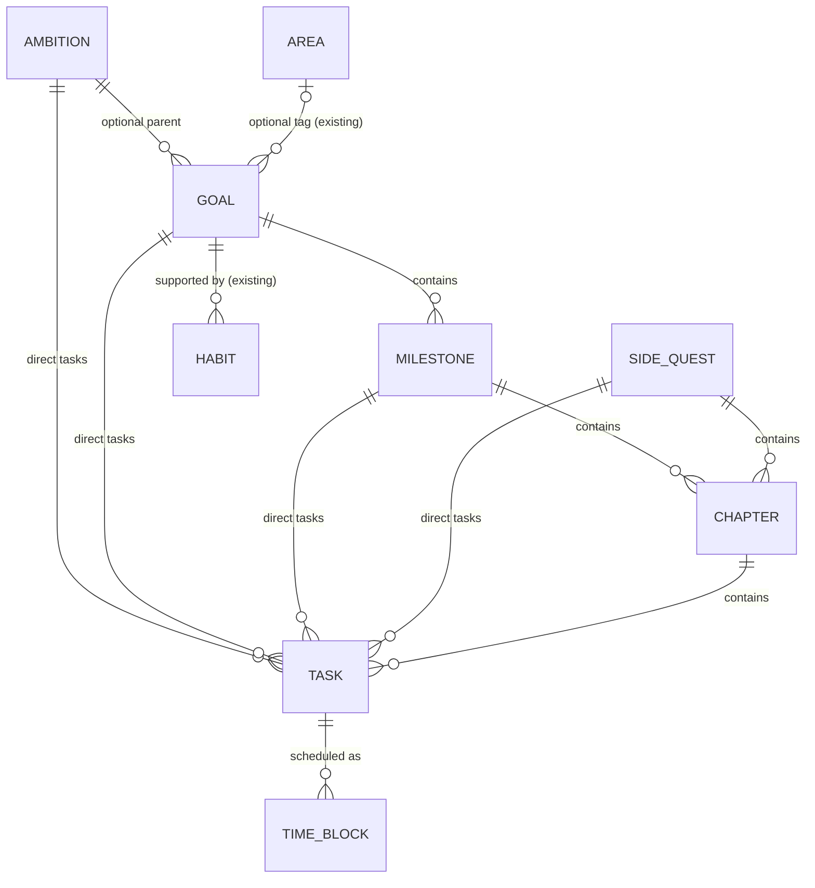

# Quests: implementation proposal (Phase 0)

Status: **proposal, waiting for approval.** No code changes until it is approved. This replaces
Track T5 ("goals review") in [2026-11-restructure.md](2026-11-restructure.md) and supersedes the
discussion brief [discussions/goals.md](discussions/goals.md).

Source brief: the "Personal Goals & Execution Platform" master prompt (8 Nov 2026). Section
numbers like "P7.2" refer to its parts.

---

## 0. Summary

- Replace today's goal tree (long / medium / short goals with checkpoint milestones) and the
  today / upcoming / someday task queue with the quest model: **Ambition → Goal → Milestone →
  Chapter → Task**, plus **Side Quests**, the **Inbox**, and **Time Blocks**.
- **One explicit table per entity**, with typed foreign keys and CHECK constraints. No generic
  "node" table and no self-referencing parent column, so hierarchy cycles are impossible by
  construction.
- **Stored vs computed.** Only explicit user decisions are stored: statuses, completion, weights,
  and order. Progress, completion eligibility, chapter state, "next action", planned effort, and
  "missed" sessions are computed when read. This matches Atlas's rule "derived values are
  computed on read" ([decision 0002](../decisions/0002-progress-computed-on-read.md)).
- **Delivered in five PRs** (§9). New tables arrive *beside* the old ones first, so `main` keeps
  working at every step. The old Goals and Tasks pages, endpoints, and tables are removed only
  in the last PR, after their data has been migrated.
- **18 decisions** need your answer (§10). Each has a recommendation; if you agree with all of
  them, say so and Q1 can start.

---

## 1. Current architecture (what exists)

| Aspect | Today |
| ------ | ----- |
| Stack | Python 3.12, FastAPI, SQLModel over SQLite, Typer admin CLI; React + Vite + TypeScript + Tailwind SPA in `web/` |
| Layers | `domain` (pure functions) ← `db` ← `services` ← `api` / `cli`. Ruff enforces the domain import ban ([overview](../architecture/overview.md)) |
| Keys | Integer primary keys inside; **slugs** on the wire for areas, metrics, habits, goals; integer ids for entries and tasks |
| Users | **Single user, no accounts, no auth**, bound to `127.0.0.1` ([decision 0001](../decisions/0001-local-first-single-user.md)). No `user_id` anywhere |
| Derived data | Computed on read (streaks, adherence, goal progress, pace, dashboards) |
| Schema changes | `CURRENT_SCHEMA_VERSION` (now **10**) in `src/atlas/db/engine.py`. `create_all` plus hand-written, idempotent migration steps. SQLite can't alter constraints, so a table is rebuilt when needed (see `_make_goal_area_nullable`) |
| Export / import | JSON with `schema_version`; import accepts every version 1–current and upgrades old payloads ([migrations](../architecture/migrations.md)) |
| Tests | domain (pure), services (in-memory SQLite), api (`TestClient`), web (vitest, jsdom for components); docs drift tests; docs gate on commits |
| UI | Night/cream theme with category accent colours, sidebar shell, cards, custom SVG charts, shadcn-style primitives |

### 1.1 How goals and tasks work today

- **`goal`**: one table for two kinds. A *metric target* goal ("weigh 75 kg") is measured from
  entries; a *milestone* goal is measured by ticking checkpoints. Each goal has a horizon
  (long / medium / short), an optional parent goal one horizon up, an optional area tag, a
  status (active / achieved / paused / abandoned), and start and due dates. **Pace** (ahead / on
  track / behind) compares progress with elapsed time.
- **`milestone`**: a manual checkpoint under a goal (name, optional due date, done timestamp).
  This is *not* the new Milestone concept.
- **`task`**: a title, a bucket (today / upcoming / someday), priority, due date, done timestamp,
  and an optional goal.
- **Links:** `habit.goal_id` (a habit can support a goal); `area_view` lists goals tagged with an
  area; Home's Tasks card; the Goals board shows "this week's linked tasks".

Files that depend on goals and tasks today: 17 backend modules (models, engine, port, services
`goals` / `tasks` / `habits` / `views` / `lookups` / `mapping`, routers `goals` / `tasks`,
schemas, serialize, domain `goals` / `horizons` / `enums`) and 16 web files (Goals, Goal, Tasks,
Area, Catalog, and Home pages, the goal / task / habit dialogs, `api.ts`, `lib/horizons.ts`,
`lib/tasks.ts`, `lib/home.ts`, Layout, and App).

### 1.2 Where today's model conflicts with the brief

| Today | Brief | Consequence |
| ----- | ----- | ----------- |
| Goals nested by horizon through `parent_id` | Fixed levels with separate tables | Horizons and goal-to-goal parents go away |
| "Milestone" = checkpoint | Milestone = intermediate outcome containing chapters and tasks | Same word, new meaning; old checkpoints need mapping (D4) |
| Metric-target goals and pace | Progress comes from children | Decide what happens to measured goals (D3) |
| Task buckets today / upcoming / someday | Status + Time Blocks + Today screen | Buckets go away (D5) |
| Goals addressed by slug | Many small entities (chapters, tasks) | Use ids for all quest entities (D8) |
| No users | The brief asks for `user_id` and ownership checks | Conflicts with decision 0001 (D1) |

---

## 2. Domain entities

Common to every container (Ambition, Goal, Milestone, Side Quest): `title`, optional
`description`, optional date, `weight` (nullable: relative to its parent), `position` (order
among siblings), `status`, `completed_at`, `archived_at`, `created_at`, `updated_at`.

| Entity | Belongs to | Contains | Extra fields | Status |
| ------ | ---------- | -------- | ------------ | ------ |
| **Ambition** | — | Goals, direct Tasks | `target_on` (optional) | `active` / `completed` / `archived` |
| **Goal** | optional Ambition | Milestones, direct Tasks | `due_on`, `success_description`, optional measured target (D3) | `active` / `completed` / `archived` |
| **Milestone** | one Goal | Chapters, direct Tasks | `due_on` | `active` / `completed` / `archived` |
| **Side Quest** | — | Chapters, direct Tasks | `due_on` | `active` / `completed` / `archived` |
| **Chapter** | exactly one Milestone **or** Side Quest | Tasks | — | **not stored**: computed as `empty` / `not_started` / `in_progress` / `completed` |
| **Task** | at most one of: Ambition, Goal, Milestone, Chapter, Side Quest | Time Blocks | `priority`, `estimate_minutes`, `due_on`, `organized_at`, `started_at` | `todo` / `in_progress` / `completed` (+ `archived_at`) |
| **Time Block** | exactly one Task | — | `start_at`, `end_at` (UTC), `provider` (`internal`), `external_event_id` | `scheduled` / `completed` / `cancelled` |

**Main Quest vs Side Quest is derived, not stored** (P3):

- A Goal and everything under it is a Main Quest.
- A Side Quest row and everything under it is a Side Quest.
- A task with no parent that has been organized is a *standalone* side quest.
- A task directly under an Ambition is neither: it shows under its Ambition (D7).

**Inbox state is derived** from `organized_at`: no parent and `organized_at` empty → Inbox; no
parent and `organized_at` set → standalone side quest; has a parent → organized. Organizing a
task sets its parent (or marks it standalone) and stamps `organized_at`. The task keeps its id,
history, and time blocks.

---

## 3. Entity relationships



---

## 4. Database schema (version 11)

Times are UTC datetimes; `*_on` columns are local dates (`ATLAS_TZ`), as everywhere in Atlas.
Status columns are string enums.

```text
ambition     id PK · title · description? · target_on? · weight? · position
             status · completed_at? · archived_at? · created_at · updated_at

goal         id PK · ambition_id? → ambition (RESTRICT) · title · description?
             success_description? · due_on? · weight? · position · area_id? → area
             status · completed_at? · archived_at? · created_at · updated_at
             [+ measured target columns, if D3 = keep]

milestone    id PK · goal_id → goal (RESTRICT) · title · description? · due_on?
             weight? · position · status · completed_at? · archived_at? · created_at · updated_at

side_quest   id PK · title · description? · due_on? · position
             status · completed_at? · archived_at? · created_at · updated_at

chapter      id PK · milestone_id? → milestone · side_quest_id? → side_quest
             title · description? · weight? · position · archived_at? · created_at · updated_at
             CHECK ((milestone_id IS NULL) <> (side_quest_id IS NULL))         -- exactly one

task         id PK · title · description? · status · priority · estimate_minutes?
             due_on? · weight? · position
             ambition_id? · goal_id? · milestone_id? · chapter_id? · side_quest_id?   (FKs)
             organized_at? · started_at? · completed_at? · archived_at? · created_at · updated_at
             CHECK ((ambition_id IS NOT NULL) + (goal_id IS NOT NULL) + (milestone_id IS NOT NULL)
                    + (chapter_id IS NOT NULL) + (side_quest_id IS NOT NULL) <= 1)  -- one parent
             CHECK (parent IS NULL OR organized_at IS NOT NULL)                     -- no parent ⇒ may be Inbox
             CHECK (status <> 'completed' OR completed_at IS NOT NULL)

time_block   id PK · task_id → task (RESTRICT) · start_at · end_at · status
             provider ('internal') · external_event_id? · created_at · updated_at
             CHECK (end_at > start_at)
             UNIQUE (provider, external_event_id) WHERE external_event_id IS NOT NULL
```

- **Indexes:** every foreign key; `task(organized_at)` for the Inbox; `time_block(start_at)` for
  Today and the Calendar.
- **Foreign keys are `RESTRICT`.** Deleting a container that still has children is refused;
  archive it instead. Hard delete is allowed for an empty container and for an Inbox task with
  no time blocks.
- **Moving a task** changes one foreign key and keeps its id, status, `completed_at`, and time
  blocks.
- **Migration from version 10** (and the import of old exports, through the same mapping): see
  D3–D5. Q1 only *adds* tables; the destructive mapping runs in Q5 (schema 12), when the old
  tables are retired.

---

## 5. Domain rules

All of these live in `src/atlas/domain/quests.py` as pure functions over plain values, so the UI
never recalculates them.

### 5.1 Structure

- Allowed parents exactly as in §2. A milestone's goal, and a chapter's milestone or side quest,
  are set on create and can be moved only within the same kind of parent.
- Archived containers accept no new children.
- No level is ever created automatically (P4).

### 5.2 Task status

- `todo → in_progress → completed`, and back from `completed` to `in_progress` or `todo`
  (reopen).
- `started_at` is stamped the first time a task leaves `todo`; `completed_at` on completion
  (cleared on reopen).
- Completing a task is always an explicit action; finishing its time blocks never completes it
  (P6.3).

### 5.3 Chapter state (computed)

`empty` when it has no non-archived tasks; `completed` when every task is completed;
`in_progress` when any task is in progress or completed; otherwise `not_started`. An empty
chapter is **never** completed (P2.4).

### 5.4 Completion eligibility (computed)

| Item | Eligible when |
| ---- | ------------- |
| Milestone / Side Quest | it has at least one child; every direct task is completed; every chapter is completed |
| Goal | it has at least one child; every direct task is completed; every milestone is completed |
| Ambition | it has at least one child; every goal and direct task is completed |

- **Completing is always explicit.** The API returns `eligible: true/false` and the list of open
  children.
- Completing an item that isn't eligible is allowed (a **manual override**), but it needs
  `override: true` in the request. Its children keep their statuses. On read, the item reports
  `completed_with_open_items: true`, and the UI shows that clearly.
- Reaching 100 % never completes anything by itself (P7.2).

### 5.5 Progress (computed)

```text
progress(task)      = 1 if completed else 0                                  (D10)
progress(container) = 1                                if container is completed (manual or not)
                    = None                             if it has no non-archived children
                    = Σ wᵢ·pᵢ / Σ wᵢ  over its non-archived children, where
                        wᵢ = child.weight if set, else 1 (equal default)
                        pᵢ = progress(child), with None counted as 0                 (D9)
```

- **Children by parent:** Ambition → goals and direct tasks; Goal → milestones and direct tasks;
  Milestone and Side Quest → chapters and direct tasks; Chapter → tasks.
- **Weights are relative to siblings.** Shown normalized as percentages; the stored numbers
  don't need to add up to 100.
- **One place:** `progress()` is the only progress algorithm, used by every view. The API also
  returns `done_tasks` / `total_tasks` counts so the UI never recounts.
- **Measured goals:** a goal's measured target (D3), if kept, is reported **beside** this
  progress, not mixed into it.

### 5.6 Next action (computed, shown on overview cards)

1. The task under the item with the earliest upcoming `scheduled` time block (from now on).
2. Otherwise the first open task in tree order (milestone → chapter → task, by position) that is
   in progress.
3. Otherwise the first `todo` task, preferring the nearest due date, then higher priority.
4. `None` when nothing is open ("Add a task" prompt).

### 5.7 Time blocks

- **Planned effort** of a task = Σ (`end_at` − `start_at`) over its non-cancelled blocks.
  - Rolled up the tree as plain sums.
  - Shown beside `estimate_minutes` (sum of estimates), never called "actual" (P6.4).
- **Completing a block:**
  - its status becomes `completed`;
  - if the task is `todo`, the task becomes `in_progress`; nothing else changes (D11).
- **Cancelling** a block keeps the row (history).
- **Missed blocks are computed, not stored:** a block still `scheduled` after its `end_at` reads
  as `unconfirmed` until you mark it completed or cancelled (D12).
- **Blocks may overlap.** The calendar flags overlaps but doesn't refuse them.
- **Blocks of a completed task** stay as they are. New blocks can't be added until the task is
  reopened.

---

## 6. Services and API

### 6.1 Code layout

| Layer | New / changed |
| ----- | ------------- |
| domain | `quests.py`: progress, eligibility, chapter state, next action, planned effort, parent validation; `enums.py` gains quest enums |
| db | `models.py`: seven tables (§4); `engine.py`: schema 11 (add) and 12 (retire old, migrate data) |
| services | `ambitions.py`, `goals.py` (rewritten in Q5), `milestones.py`, `side_quests.py`, `chapters.py`, `tasks.py` (rewritten), `time_blocks.py`, `quest_views.py`; `port.py`; `seed.py` |
| api | routers `ambitions`, `goals`, `milestones`, `side_quests`, `chapters`, `tasks`, `time_blocks`, `quest_views` |

### 6.2 Endpoints (all ids are integers; D8)

| Method | Path | Purpose |
| ------ | ---- | ------- |
| `GET` `POST` | `/ambitions` | List (with progress), create |
| `GET` `PATCH` `DELETE` | `/ambitions/{id}` | Read, edit (title, description, date, weight, position, archive), delete if empty |
| `POST` | `/ambitions/{id}/complete` · `/reopen` | Explicit completion (`override` when not eligible) |
| `GET` `POST` | `/goals` | List, create (`ambition_id` optional) |
| `GET` `PATCH` `DELETE` | `/goals/{id}` | Read, edit, move to another ambition or none, delete if empty |
| `POST` | `/goals/{id}/complete` · `/reopen` | As above |
| `POST` / `PATCH` / `DELETE` | `/milestones`, `/milestones/{id}`, `…/complete`, `…/reopen` | Same pattern (`goal_id` required) |
| `POST` / `PATCH` / `DELETE` | `/side-quests`, `/side-quests/{id}`, `…/complete`, `…/reopen` | Same pattern |
| `POST` / `PATCH` / `DELETE` | `/chapters`, `/chapters/{id}` | Same pattern (`milestone_id` xor `side_quest_id`); no completion endpoint |
| `GET` `POST` | `/tasks` | List with filters (`parent`, `status`, `inbox=true`, `standalone=true`); create. No parent = Inbox capture (only `title` required) |
| `GET` `PATCH` `DELETE` | `/tasks/{id}` | Edit (status, priority, estimate, due, weight, position, archive); delete only for Inbox tasks without blocks |
| `POST` | `/tasks/{id}/organize` | `{parent: {kind, id}}` or `{standalone: true}`. Moves the task and keeps its identity. Also used to move between parents |
| `POST` | `/tasks/{id}/promote` | Turn an Inbox task into a new Ambition / Goal / Milestone / Side Quest / Chapter (D6) |
| `GET` `POST` | `/time-blocks` | List by range (`start`, `end`) or `task_id`; create |
| `PATCH` `DELETE` | `/time-blocks/{id}` | Move or resize; delete a block created by mistake |
| `POST` | `/time-blocks/{id}/complete` · `/cancel` | Session outcome (never completes the task) |
| `GET` | `/views/main-quests` | Cards: ambitions (with goals), independent goals; progress, counts, next action |
| `GET` | `/views/goals/{id}/tree` | Full hierarchy of one goal with computed state on every node |
| `GET` | `/views/side-quests` | Structured side quests and standalone tasks, with state |
| `GET` | `/views/today` | Today's blocks with task and parent path, unconfirmed blocks, tasks due today, a few suggested open tasks |
| `GET` | `/views/calendar` | Blocks in a range (`start`, `end`) with task title and parent path |

Errors follow [api-conventions](../architecture/api-conventions.md): invalid parent or archived
parent → 400; unknown id → 404; deleting a container that has children → 409.

---

## 7. UI: navigation and screens

### 7.1 Navigation

The sidebar's **Goals** and **Tasks** entries are replaced by a **Quests** group:

```text
Today          today's sessions and what to do next
Inbox    (3)   count of unorganized items
Main Quests
Side Quests
Calendar
```

- Home keeps its role as the overall life dashboard. Its Tasks card becomes **Today's quests**
  (today's blocks and the next action) (D13).
- Habits stay where they are. The habit ↔ goal link is kept and shown on goal detail as
  "Supporting habits".
- The rest of the sidebar waits for the navigation discussion.

### 7.2 Visual direction

- **Look:** quest-journal feel inside the existing theme. One quest accent colour (the current
  goal green) plus neutrals; no extra colours per level.
- **Levels are told apart by icon and shape, not colour:**
  - Ambition: compass, large card
  - Goal: flag, card
  - Milestone: diamond node
  - Chapter: bookmark, section
  - Task: round checkbox row
  - Side Quest: scroll
- **Progress** is a thin bar on rows and a ring on cards. "Completed with open items" shows a
  small notice.
- **No dense tables** as the main view.

### 7.3 Screens

| Screen | Route | Content |
| ------ | ----- | ------- |
| Main Quests | `/quests` | Ambition sections, each with its goal cards and a "direct tasks" strip; then independent goals. Ambitions without goals stay visible with an "Add a goal" prompt. Cards: title, description, progress ring, target date, status, counts, next action. No full trees here |
| Goal detail | `/quests/goals/:id` | Quest map: the goal at the top, milestones as nodes on a vertical path, each expandable into chapters and tasks. Add-child buttons at every level; parent breadcrumb (Ambition › Goal); success description; supporting habits; completion control with eligibility and override |
| Ambition detail | `/quests/ambitions/:id` | Its goals (cards) and direct tasks |
| Side Quests | `/side-quests` | Structured side quests as compact cards with progress, and a list of standalone tasks, using the same row and tree components |
| Side Quest detail | `/side-quests/:id` | The same tree component as a milestone (chapters plus direct tasks) |
| Inbox | `/inbox` | Always-focused capture field (Enter adds). Each item: edit title and description, **Organize…** (search-as-you-type picker over the hierarchy), **Make standalone**, **Turn into…** (D6), Archive |
| Today | `/today` | Timeline of today's blocks (time, task, parent path). Each block has **Session done** and, separately, **Outcome achieved** (completes the task, with a confirmation the first time). Unconfirmed earlier blocks to resolve; tasks due today; "Up next" suggestions; quick schedule button |
| Calendar | `/calendar` | Week view (Mon–Sun, hours). Click an empty slot to create a block (pick a task); click a block to move, resize, complete, or cancel. No drag in V1 (D15) |
| Task panel | side drawer from anywhere | Title, description, status, priority, estimate, due date, parent (move), weight, list of blocks with planned-effort total, Schedule button |

Shared components (`web/src/components/quests/`): `QuestCard`, `QuestTree` and `QuestNode`,
`TaskRow`, `TaskDrawer`, `ProgressRing` / `ProgressBar`, `EntityIcon`, `OrganizePicker`,
`TimeBlockDialog`, `CompletionControl`.

---

## 8. Tests (P11 acceptance criteria)

| Criteria | Layer |
| -------- | ----- |
| 1–9 (creating every supported structure, including mixed children and missing levels) | services + api |
| 10–12 (Inbox capture, organize without duplication, move keeping id / status / blocks) | services + api |
| 13–14 (several blocks per task; block completion leaves the task in progress) | services + api |
| 15–18 (chapter completion, empty chapter, milestone and goal eligibility) | domain (pure) + services |
| 19 (manual override keeps children) | services + api |
| 20 (weighted progress, including None and default weights) | domain (pure) |
| 21 (missing levels never error) | domain + services + api over every structure in P4 |
| 22 (ownership boundaries) | not applicable while Atlas is single-user (D1) |
| Migration and import | schema 10 → 11 → 12 against a v10 fixture; import of v1–10 exports maps old goals and tasks per D3–D5 |
| UI | vitest + jsdom: tree rendering, Inbox organize flow, Today session vs outcome controls; Playwright smoke run on seeded data |

---

## 9. Implementation sequence

Each step is one PR on its own branch, using the parallel-work rules in
[development/parallel-work.md](../development/parallel-work.md).

| PR | Branch | Content | Depends on |
| -- | ------ | ------- | ---------- |
| **Q1** | `feature/quests-domain` | Schema 11 (new tables beside the old ones), domain rules, services, API, seed data for quests, export/import of new tables, ADR 0006 (quest model), `docs/domain/quests.md`, `time-blocks.md` (model only). Old Goals and Tasks keep working | approval |
| **Q2** | `feature/quests-ui` | Quests sidebar group; Main Quests, goal/ambition detail with quest map, Side Quests, Inbox, task drawer, create/edit/organize flows | Q1 |
| **Q3** | `feature/quests-execution` | Time Block API and UI, Today, Calendar week view, planned effort, Home "Today's quests" card | Q1 (parallel with Q2: Q3 owns Today, Calendar, time-block components; Q2 owns the rest; the task drawer's block list is added by Q3 after Q2 merges) |
| **Q4** | `feature/quests-progress-polish` | Weight editing, completion override UX, next-action tuning, empty/edge states, visual polish | Q2, Q3 |
| **Q5** | `feature/quests-retire-old` | Schema 12: migrate old goals, checkpoints, and tasks into the new tables (D3–D5); remove the old Goals and Tasks pages, endpoints, `horizons`, pace (unless kept by D3), and the old tables; update import for v1–11 exports | Q4 |

Phase 4 (accountability) and Phase 5 (Google Calendar) of the brief stay out of scope. The model
already has `provider` / `external_event_id` and keeps history (statuses, timestamps, cancelled
blocks), so they need no rewrite later.

The T6 polish sweep can run alongside Q1. The navigation discussion (T2) stays separate; Q2 only
changes the Quests part of the sidebar.

---

## 10. Decisions needed (with recommendations)

| # | Question | Recommendation |
| - | -------- | -------------- |
| D1 | The brief asks for `user_id` and ownership checks, but Atlas is single-user with no accounts (decision 0001). Add users now? | **No.** Keep single-user; acceptance criterion 22 doesn't apply. Adding ownership later is one migration because every table is explicit. |
| D2 | Keep the area tag on goals? | **Keep it** (optional, as today); revisit in the navigation discussion. |
| D3 | Measured goals ("Save €20,000", "Weigh 75 kg") use entries today, with pace. | **Keep an optional measured target on Goal** (metric, target, how it's measured), shown as its own bar with pace, **beside** task progress, not mixed in. Goals without one show no pace. |
| D4 | Old checkpoint "milestones" | **Become Tasks** under the new goal (completed if they were done). |
| D5 | Mapping old goals and tasks in Q5 | long-horizon goals → **Ambitions**; medium → **Goals** under their parent's ambition; short → **Milestones** under their parent goal (or Goals if they have none); tasks keep their goal link (or become standalone side quests); buckets are dropped. The current data is demo data, so a best-effort mapping is fine. |
| D6 | "Create a new structural entity from an Inbox item" vs "preserve identity" | **Turn into…** creates the new container from the item's title and description and removes the Inbox task. Allowed only while the task has no time blocks; otherwise the task is moved under the new container instead. |
| D7 | Where do tasks directly under an Ambition appear? | Under their **Ambition** (Main Quests page and ambition detail), not in Side Quests. |
| D8 | Keys | **Integer ids** for all quest entities in the API and URLs (titles aren't unique). The habit ↔ goal link switches from goal slug to goal id in Q5. |
| D9 | How empty or not-yet-decomposed children count | An item with no children shows **"Not broken down yet"** (no percentage). Inside a parent, it counts as **0 %** with its weight, which is honest: it's work not started. |
| D10 | Does an in-progress task count partly? | **No:** 0 until completed. Partial credit would make progress depend on planned time, which isn't real effort. |
| D11 | Completing a session of a `todo` task | The task moves to **in progress** automatically. |
| D12 | Missed sessions | Computed **"unconfirmed"** state for past scheduled blocks, resolved from Today; a stored `missed` status waits for Phase 4. |
| D13 | Home vs Today | **Both:** Home stays the life dashboard with a "Today's quests" card; `/today` is the execution screen. |
| D14 | Do Side Quests get weights? | **No** (they have no parent). Their chapters and tasks do. |
| D15 | Calendar interaction in V1 | **Click to create and edit**; drag and resize later. |
| D16 | Ordering | Manual **position** per sibling list, with up/down controls in V1 (drag later). |
| D17 | Priorities | **low / normal / high** (as today). |
| D18 | Habits | Keep the habit ↔ goal link and show "Supporting habits" on goal detail. Habits **don't** count toward goal progress in V1. |

## 11. Risks

- **Scope.** Five PRs, the largest change to Atlas so far. Mitigation: old features stay working
  until Q5, and each PR is reviewable on its own.
- **SQLite constraints.** The new tables get CHECKs from the start; the old `goal` / `task`
  tables are rebuilt only in Q5, using the existing table-rebuild pattern.
- **Progress semantics.** "None counts as 0" (D9) can make progress drop when you add an empty
  milestone. That's intentional and documented, and the UI shows why.
- **Navigation overlap.** Q2 changes the sidebar before the navigation discussion is finished.
  Limited to swapping Goals and Tasks for the Quests group.
- **Data mapping.** Old exports must still import (Atlas promise). Q5 tests a v10 fixture
  end to end.
